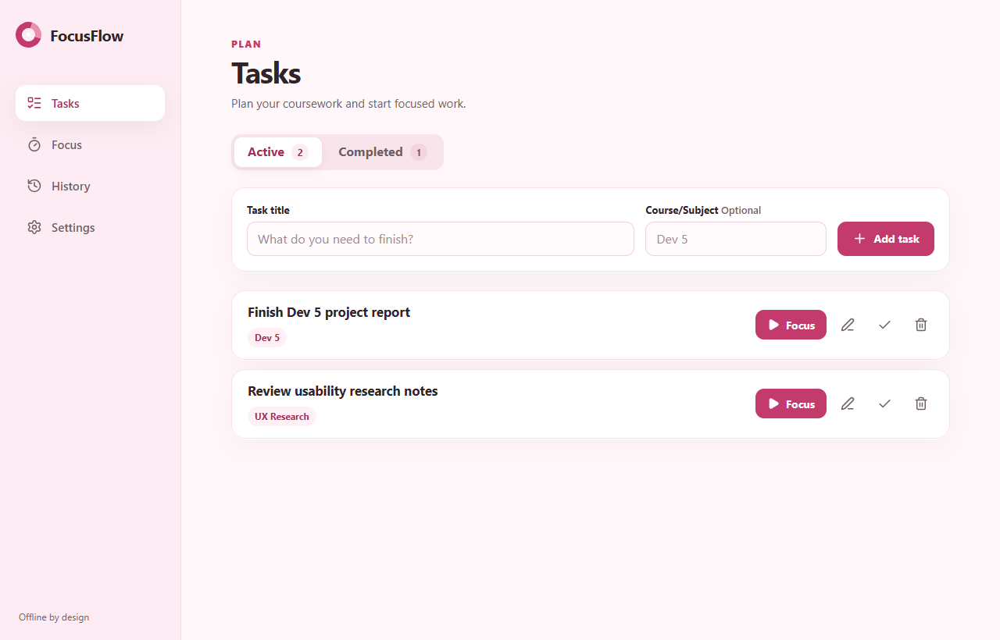
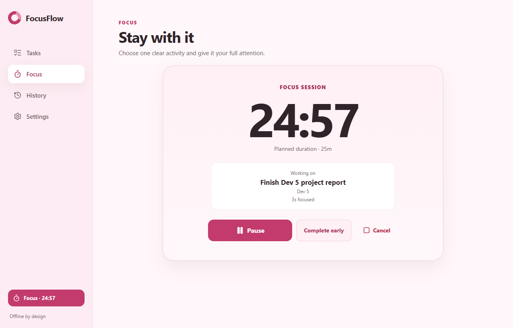
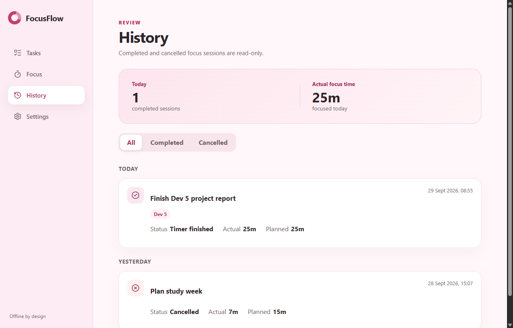
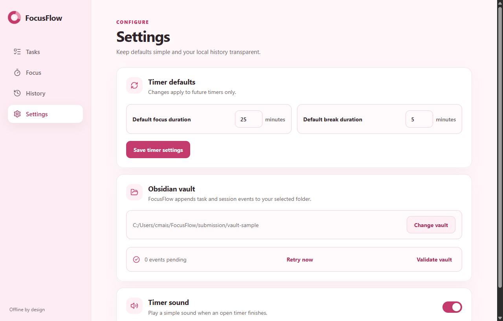

# FocusFlow — Product and Development Report

**Course:** Dev 5<br>
**Student:** [add your name]<br>
**Report date:** 29 September 2026<br>
**Repository:** https://github.com/CassyStudent/FocusFlow

## 1. Project summary

FocusFlow is an offline desktop application for students. It combines a small task list, a focus timer, read-only session history and append-only Markdown output for an Obsidian vault. The main goal is to reduce the friction between deciding what to study, doing a focused session and keeping a transparent record afterwards.

The project is deliberately narrow. It does not include accounts, cloud synchronization, social features, gamification, complex project management or analytics dashboards. This boundary keeps the application realistic for a student assignment and makes its architecture explainable.

At the time of this report, the core task, timer, history, settings, SQLite and Obsidian-outbox flows are implemented. The timer-sound preference is stored, but actual audio playback is not yet implemented. The repository is local and does not yet have a GitHub remote; the repository URL above must therefore be replaced after publishing.

## 2. Research

### 2.1 Focus method

The Pomodoro Technique influenced the timer defaults, but FocusFlow is not presented as a full Pomodoro implementation. The official site describes the method as a broader productivity system rather than only a timer.[1] Cirillo's original guide describes the traditional cycle as 25 minutes of work followed by a short break, which supports the application's initial 25-minute focus and 5-minute break defaults.[2]

The product adapts this idea for students by allowing:

- a focus session linked to an active task;
- a standalone activity when no task is appropriate;
- pause and resume;
- completion at the planned end time;
- an explicit “complete early” outcome;
- cancellation that preserves the actual elapsed time;
- configurable focus and break durations.

This adaptation is intentional. The app borrows the clear time-boxing pattern but does not claim to reproduce every planning and interruption rule of the full technique.

### 2.2 Local-first notes and Obsidian

Obsidian stores notes as Markdown-formatted plain-text files inside a vault, where a vault is a folder on the local file system.[3] This matches FocusFlow's local-first goal and makes generated history easy to inspect without locking the user into a proprietary database format.

FocusFlow treats Markdown as an audit output rather than its operational database. The application stores current state in SQLite, then appends events to daily Markdown files in this structure:

```text
FocusFlow/
├── Tasks/
│   └── YYYY-MM-DD.md
└── Sessions/
    └── YYYY-MM-DD.md
```

This separation matters. SQLite answers questions such as “what tasks exist now?” and “is a timer currently active?”, while the vault provides a readable chronological record of what happened.

### 2.3 Desktop and data technology

Tauri supports desktop applications that use an HTML/CSS/JavaScript frontend and can use Rust for backend logic.[4] This made it suitable for combining a familiar Vue interface with a narrow native boundary for SQLite, folder selection and safe file writing.

SQLite was chosen for operational storage because it provides ACID transactions and supports transactional updates in a single local application file.[5] FocusFlow uses a transaction to save an operational change and its matching outbox event together. If writing to the vault fails later, the local change remains saved and the event stays pending for retry.

Vue's Composition API and `<script setup>` fit the component structure used in this project; the Vue documentation recommends `<script setup>` for concise Composition API use in single-file components.[6] This choice also stays close to technology I already understand, which makes the final implementation easier to explain and maintain.

### 2.4 Accessibility and visual research

The interface uses a light-pink identity, but important text remains dark and status is communicated with wording and icons as well as color. WCAG guidance uses a 4.5:1 contrast threshold for normal text.[7] The design plan therefore checked representative combinations, including dark text on the light background and white text on the primary pink button.

The visual references were used for principles rather than copied as templates. The task-management reference contributed a persistent sidebar, clear rows and restrained density. The timer reference contributed a large countdown and obvious primary action. Features outside the PRD—such as accounts, upgrades, leaderboards, AI panels and complex analytics—were explicitly excluded.

## 3. Product Requirements Document (PRD)

### 3.1 Problem statement

Students often separate task planning, focus timing and study records across several tools. This creates extra steps and makes it difficult to see which task a completed focus session belonged to. FocusFlow should provide one small offline workflow from planning to focused work to readable history.

### 3.2 Target user

The primary user is a student who:

- plans coursework on a Windows desktop or laptop;
- wants a simple focus timer without social or account features;
- values offline control and readable local files;
- may already use Obsidian for notes;
- needs a system that is quick to understand and does not require extensive setup.

### 3.3 Product goal

Enable a student to create a task, start a linked focus session, recover or finish that timer reliably, review immutable session history and append the event trail to an Obsidian-compatible folder.

### 3.4 Required features

#### Tasks

- Create a task with a required title and optional Course/Subject.
- Validate title and course length.
- Show active and completed tasks separately.
- Edit active tasks.
- Complete and reopen tasks.
- Delete tasks after confirmation.
- Preserve historical session snapshots when a task is later edited or deleted.
- Prevent mutation of a task while it is linked to the active focus timer.

#### Focus timer

- Start from one active task or one standalone activity.
- Use a configurable planned duration from 1 to 180 minutes.
- Show a large remaining-time display.
- Pause and resume.
- Complete automatically when the timer reaches zero.
- Complete early with confirmation.
- Cancel with confirmation while preserving actual elapsed time.
- Offer a configurable break after a completed focus session.
- Recover a running or paused timer after reopening the desktop app.
- Derive elapsed time from timestamps instead of trusting interval ticks.

#### History

- Store completed and cancelled focus sessions as immutable records.
- Show subject snapshots, planned duration, actual duration, status and end time.
- Group entries by local date.
- Filter All, Completed and Cancelled.
- Calculate today's completed-session count and actual focused duration.
- Exclude breaks from history.

#### Settings and onboarding

- Select and validate a writable vault folder.
- Create `FocusFlow/Tasks` and `FocusFlow/Sessions` inside that folder.
- Warn when the chosen folder does not contain an Obsidian `.obsidian` directory.
- Configure default focus and break duration.
- Store the timer-sound preference.
- Show pending vault events and provide Retry Now.
- Require explicit approval before redirecting pending events to a different vault.

#### Persistence and vault output

- Use SQLite as the authoritative operational store.
- Save each application change and matching outbox record atomically.
- Append events to daily Markdown files.
- Store a unique Event ID in every Markdown entry.
- Check Event IDs before appending so retries do not duplicate entries.
- Escape user-entered Markdown control characters.
- Reject unsafe identifiers, path traversal and symbolic-link/reparse-point targets.

### 3.5 Non-goals

- User accounts or login.
- Cloud synchronization.
- Mobile application.
- Team collaboration.
- AI-generated task planning.
- Projects, priorities, subtasks or dependencies.
- Streaks, achievements or leaderboards.
- Long-break automation.
- Detailed productivity analytics or charts.
- Editing historical records.

### 3.6 Success criteria

A successful version allows the complete central workflow to run locally:

1. configure a vault;
2. create a task;
3. start a focus session linked to it;
4. pause/resume or finish/cancel it;
5. reopen the application without losing timer state;
6. view the resulting history;
7. find matching non-duplicated Markdown events in the selected vault.

## 4. Design choices

### 4.1 Visual identity

The application uses a consistent light-pink design system:

| Token | Value | Purpose |
|---|---|---|
| App background | `#FFF7FA` | Main canvas |
| Sidebar | `#FDECF3` | Persistent navigation |
| Soft accent | `#FFF0F5` | Selected and highlighted areas |
| Card surface | `#FFFFFF` | Forms, rows and dialogs |
| Primary pink | `#C23B6C` | Main actions and active navigation |
| Primary hover | `#A82E59` | Hover/pressed state |
| Border | `#F0CEDA` | Inputs, cards and dividers |
| Strong text | `#2F2429` | Headings and body text |
| Muted text | `#6F5F66` | Supporting information |
| Destructive | `#B4233E` | Delete and cancel actions |

Rounded cards, shallow shadows and generous spacing create a calm study-oriented interface. Pink stays dominant, while destructive actions use a separate rose treatment and warnings use words/icons rather than color alone.

### 4.2 Navigation and screen roles

The persistent sidebar keeps the four product areas visible:

- **Tasks — Operate:** create and manage study work.
- **Focus — Monitor/Operate:** watch the timer and use explicit controls.
- **History — Monitor:** review immutable session records.
- **Settings — Configure:** manage defaults, vault state and recovery.

This division avoids combining unrelated controls into one dashboard.

### 4.3 Error and recovery design

Local persistence errors are blocking because the interface must not claim success when SQLite did not save. Vault-write errors are recoverable because the operational change is already committed and its event can remain in the outbox. Forms retain their values after validation or persistence failure.

The timer uses a timestamp-based state machine. The visible countdown refreshes on an interval, but the stored timestamps determine elapsed time. This is more reliable when a laptop sleeps or the application closes.

### 4.4 Data snapshots

A focus session stores the task title and course as snapshots. This prevents later task edits or deletion from changing the meaning of old history. History therefore remains readable and stable.

## 5. Implementation overview

### Frontend

- Vue 3 single-file components with Composition API.
- Pinia store for cross-route application state.
- Vue Router for Tasks, Focus, History, Settings and onboarding.
- SCSS design tokens and reusable button/card/dialog patterns.
- A browser backend adapter for fast component development and tests.

### Desktop backend

- Tauri 2 desktop shell.
- Rust commands as the controlled boundary between UI and native operations.
- SQLite via `rusqlite` with an initial migration.
- Tables for tasks, sessions, settings, active timer, used IDs and outbox events.
- Safe vault validation, folder creation and append-only Markdown delivery.

### Failure-safe outbox

The backend creates the outbox payload during the same SQLite transaction as the task or session change. Delivery happens afterwards. A failed file write records an error and stops the current retry batch; successful or already-present Event IDs are marked delivered.

## 6. Application visuals

### Tasks



The Tasks screen prioritizes quick creation and keeps row actions compact. Active and completed counts come from real data, and destructive actions are visually separated.

### Running focus session



The countdown is the visual anchor. The selected task, course and actual focused time remain visible, while Pause is the main action and completion/cancellation remain explicit.

### History



History shows a small daily summary rather than a full analytics dashboard. Completed and cancelled records have visible labels and immutable duration details.

### Settings



Settings are arranged as a single column of cards. Timer defaults, vault location, pending-event recovery and sound preference remain understandable without adding advanced configuration.

## 7. Obsidian vault example

The included `vault-sample` folder was generated by running the actual Rust backend against a temporary SQLite database and then delivering its outbox to the selected folder. The generation run delivered seven events with zero failures. The resulting sample contains two Markdown files.

### Task entry excerpt

```markdown
## Task: Finish Dev 5 project report
- Event ID: event-task-report-created
- Timestamp: 2026-09-29T06:20:00.000000000Z +02:00
- Event type: task_created
- Status: active
- Task ID: task-dev5-report
- Title: Finish Dev 5 project report
- Course/Subject: Dev 5
```

### Completed session excerpt

```markdown
## Focus: Finish Dev 5 project report
- Event ID: event-session-report-completed
- Timestamp: 2026-09-29T06:55:00.000000000Z +02:00
- Event type: focus_completed
- Status: completed
- Session ID: session-dev5-report
- Task ID: task-dev5-report
- Task title: Finish Dev 5 project report
- Course/Subject: Dev 5
- Activity: None
- Planned seconds: 1500
- Actual seconds: 1500
- Completion type: timer_finished
```

### Cancelled standalone session excerpt

```markdown
## Focus: Plan study week
- Event ID: event-session-plan-cancelled
- Timestamp: 2026-09-29T07:07:00.000000000Z +02:00
- Event type: focus_cancelled
- Status: cancelled
- Session ID: session-study-plan
- Task ID: None
- Task title: None
- Course/Subject: None
- Activity: Plan study week
- Planned seconds: 900
- Actual seconds: 420
- Completion type: None
```

These entries demonstrate active/completed task events, a completed linked session and a cancelled standalone activity. Event IDs make retries checkable and prevent silent duplication.

## 8. Verification

The following checks were run on 29 September 2026:

| Check | Result |
|---|---|
| Frontend unit/component tests | 29 passed across 7 test files |
| Frontend production build | Passed with Vite |
| Rust backend tests | 21 passed |
| Rust Clippy with warnings denied | Passed |
| Vault sample delivery | 7 delivered, 0 already present, 0 failed |
| Generated sample records | 2 tasks, 2 sessions, 7 delivered outbox events |
| Visual review | Tasks, running timer, history and settings screenshots inspected |

The repository was published publicly at `https://github.com/CassyStudent/FocusFlow` on 29 September 2026. The implementation and submission artifacts are included in the repository.

## 9. AI use note

Hermes Agent was used as a development and documentation assistant. It helped inspect the repository, run tests and builds, review implementation choices, capture application screenshots, generate the report structure and create a reproducible vault sample through the actual backend code. AI assistance was also used to improve wording and organize evidence.

The application scope, design direction and technical decisions were kept within the approved student-project boundary. Generated material should still be reviewed by me before submission so that I can explain every feature, dependency and design decision in my own words. No AI service is required by the FocusFlow application at runtime.

## 10. Reflection

The most important lesson from this project was that a small offline app still needs clear data boundaries. At first, writing directly to Markdown could appear simpler, but it would make timer recovery, task mutation and reliable retries difficult. Separating SQLite operational state from append-only Obsidian history made the design more robust and easier to reason about.

I also learned that timer correctness should not depend on a visible interval. Persisted timestamps make pause, resume and recovery explainable even when the application is closed or the computer sleeps. Snapshotting task information into session history was another important decision because historical records should not change when current tasks change.

The main challenge was controlling scope. It was tempting to add analytics, projects, themes and more timer modes, but those features would reduce the time available for reliability and testing. The final product is stronger because it focuses on one complete workflow.

If I continued the project, my next steps would be to implement the stored timer-sound preference, complete final desktop packaging checks, improve keyboard/focus testing and publish the verified repository with clear setup instructions.

## Sources

[1] https://www.pomodorotechnique.com — The Pomodoro Technique
[2] https://www.faasafety.gov/files/events/SO/SO15/2024/SO15134204/Cirillo_--_Pomodoro_Technique.pdf — The Pomodoro Technique (Francesco Cirillo)
[3] https://help.obsidian.md/data-storage — How Obsidian stores data
[4] https://v2.tauri.app/start — What is Tauri?
[5] https://www.sqlite.org/features.html — Features of SQLite
[6] https://vuejs.org/api/composition-api-setup.html — Vue Composition API setup
[7] https://www.w3.org/WAI/WCAG22/Understanding/contrast-minimum — WCAG 2.2 Contrast Minimum
